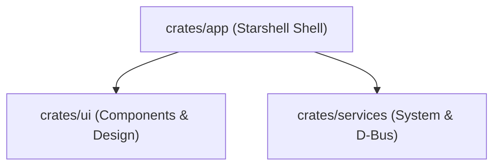

# Contributing to Starshell

Thank you for your interest in contributing to **Starshell**! Whether you are improving system integrations, refining UI components, or designing new widgets, this guide outlines the standards and conventions to keep Starshell fast, clean, and maintainable.

---

## 1. Architecture & Crates Overview

Starshell is built in Rust using **GPUI** (the GPU-accelerated UI framework from Zed) and is strictly organized into decoupled crates:



* **`crates/ui`**: Pure design system, theme engines, and reusable components (`Button`, `Card`, `Chip`, `Badge`, `Tooltip`, `Slider`, `Switch`, `Input`).
  * *Rule:* Never import system commands, D-Bus, or desktop-specific I/O here.
* **`crates/services`**: Asynchronous backend services, D-Bus listeners (`zbus`), hardware controls (volume, brightness, power), media players (`mpris`), and screen recorders.
  * *Rule:* Never import GPUI or UI elements here. All long-running tasks run in background Tokio tasks.
* **`crates/app`**: The layer-shell application orchestrating window management, modules, satellites, orbits, and settings views.

---

## 2. Modularity & Clean Structure

To prevent massive monoliths, Starshell enforces high cohesion and strict file modularity:

* **Slim Parent Modules (`mod.rs`)**: Keep parent `mod.rs` files under 100 lines. They should only declare submodules, re-export public APIs, and act as lightweight coordinators.
* **Feature Isolation**: Place distinct responsibilities in their own files:
  * For example, in `services/src/system/`, volume/sinks live in `audio.rs`, backlight in `brightness.rs`, and power commands in `power.rs`.
* **Zero Blocking on UI Thread**: Never call `futures::executor::block_on` or run blocking operations inside render methods. Always delegate async work to `crate::spawn_tokio` and communicate back through channels or `cx.update(...)`.
* **Defensive Timeouts**: Wrap external command executions (`wpctl`, `brightnessctl`, etc.) in `tokio::time::timeout` (e.g. 1.5–2s) so a hung system utility never hangs Starshell.

---

## 3. UI Design Standards (`starshell-design`)

Starshell features a solid, theme-aware desktop style. Any new UI work must follow these principles:

1. **Opaque Surfaces**:
   * Windows and content cards use solid, opaque backgrounds (`theme.surface()`, `theme.card()`, `theme.raised_card()`).
   * Avoid desktop-bleed or decorative blurs, with the exception of media player artwork.
2. **Consistent Radii**:
   * Main cards use `CARD_RADIUS` (`16.0px`).
   * Nested cards, controls, and chips use `INNER_RADIUS` (`12.0px`) or standard grid multiples (4px, 6px, 8px).
3. **Adaptive Contrast (`on_accent`)**:
   * When drawing text or icons over accent-colored elements (e.g., primary buttons or active chips), use `theme.on_accent()` to dynamically calculate luminance and pick optimal readable contrast.
4. **Zero Idle CPU**:
   * Animation loops must stop immediately when motion settles (`content_progress >= 1.0`).
   * Never introduce continuous frame-polling in widgets or satellites.
5. **Use the Standard Component Suite**:
   * Always prefer standard components in `crates/ui/src/components/` (`Button`, `IconButton`, `Chip`, `Badge`, `Card`, `Tooltip`) over ad-hoc divs with manual mouse event handlers.

---

## 4. Development & Testing Workflow

### Prerequisites
* Rust toolchain (stable, 2024 edition / latest stable)
* Wayland compositor (Hyprland, Niri, Sway, or MangoWM recommended for testing layer-shell features)
* System dependencies: PulseAudio/PipeWire development headers, D-Bus (`libdbus-1-dev`), fontconfig, etc.

### Running & Verifying
Always test your changes locally before submitting a PR:

```bash
# Verify compilation across all crates with 0 warnings
cargo check --workspace

# Run the complete test suite (all tests must pass)
cargo test --workspace

# Run Starshell in development mode
cargo run --bin starshell
```

---

## 5. Branching & Commit Guidelines

1. **Create a descriptive branch** from `master` or `main`:
   * `feat/battery-indicator`
   * `fix/audio-sink-timeout`
   * `refactor/notification-service`

2. **Conventional Commits**:
   Write clear, concise commit messages in English following the Conventional Commits specification:

   ```text
   feat(ui): add Chip and Badge components
   fix(services): add timeout to brightnessctl execution
   refactor(services): split record service into options and session
   style(app): harmonize appearance card preview border radius
   docs: update contribution guidelines
   ```

3. **Pull Request Checklist**:
   * [ ] Code adheres to the crate boundaries and modularity rules.
   * [ ] `cargo check --workspace` passes with 0 warnings and 0 errors.
   * [ ] `cargo test --workspace` passes 100%.
   * [ ] PR description clearly explains what problem is being solved and includes screenshots/recordings for UI changes.