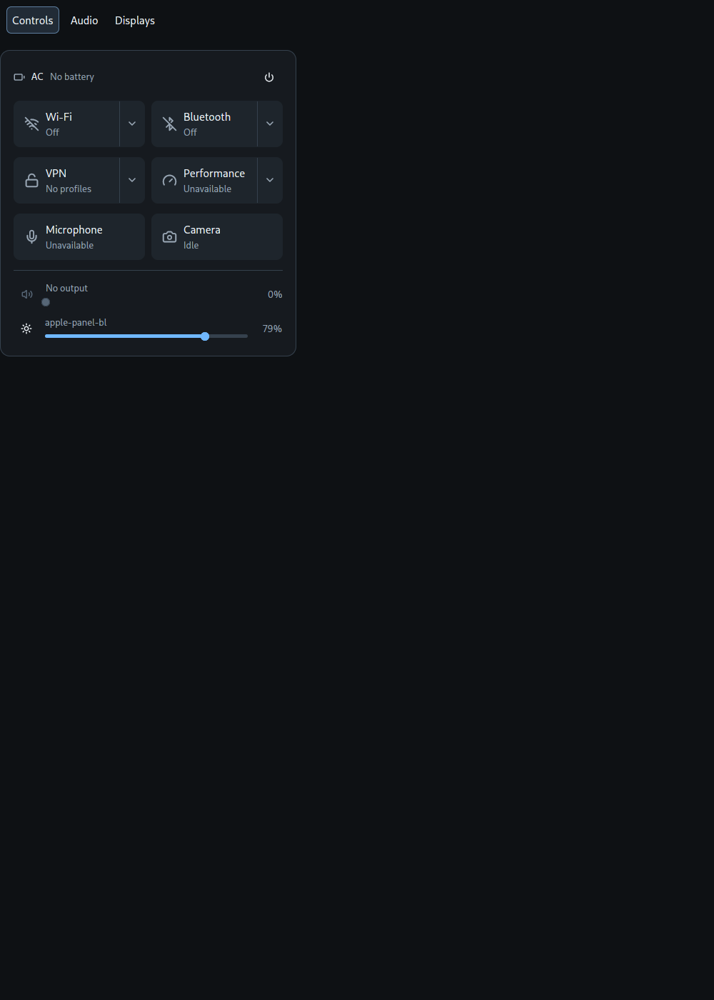
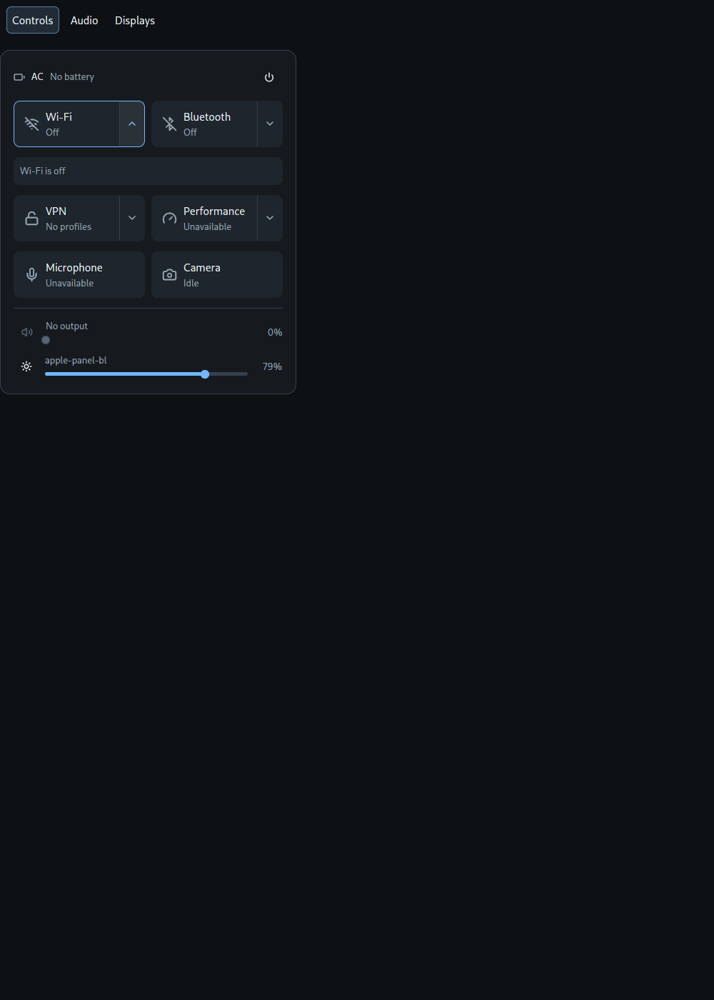
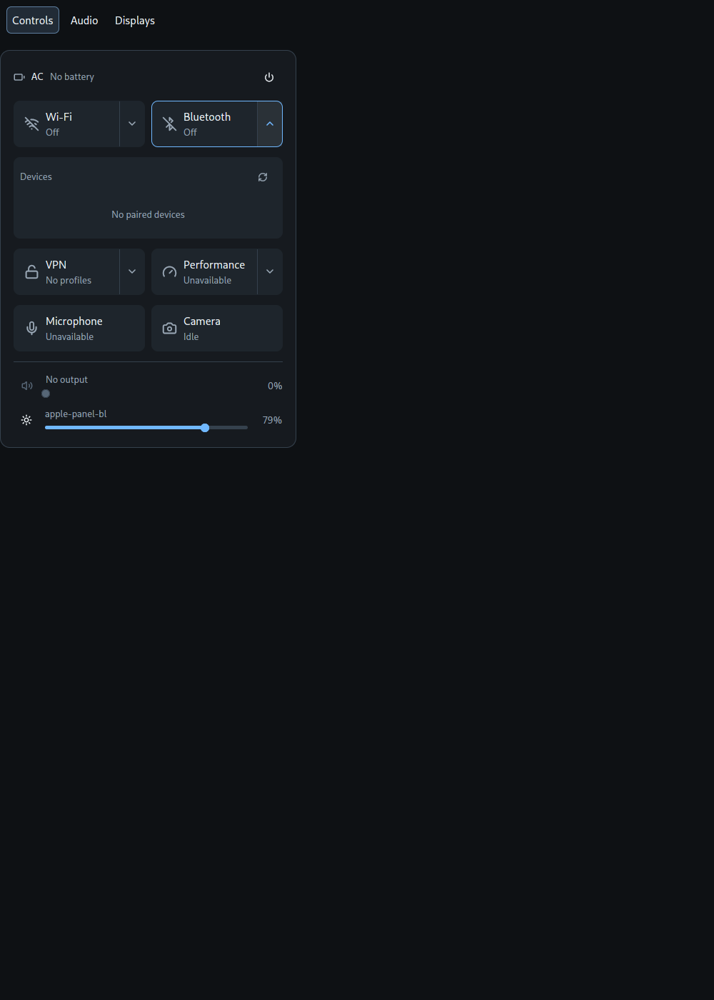
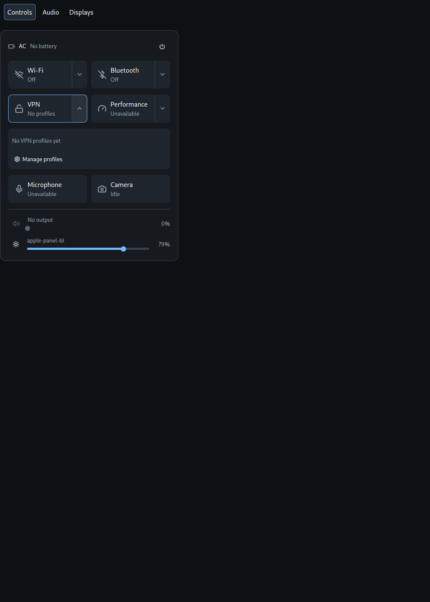
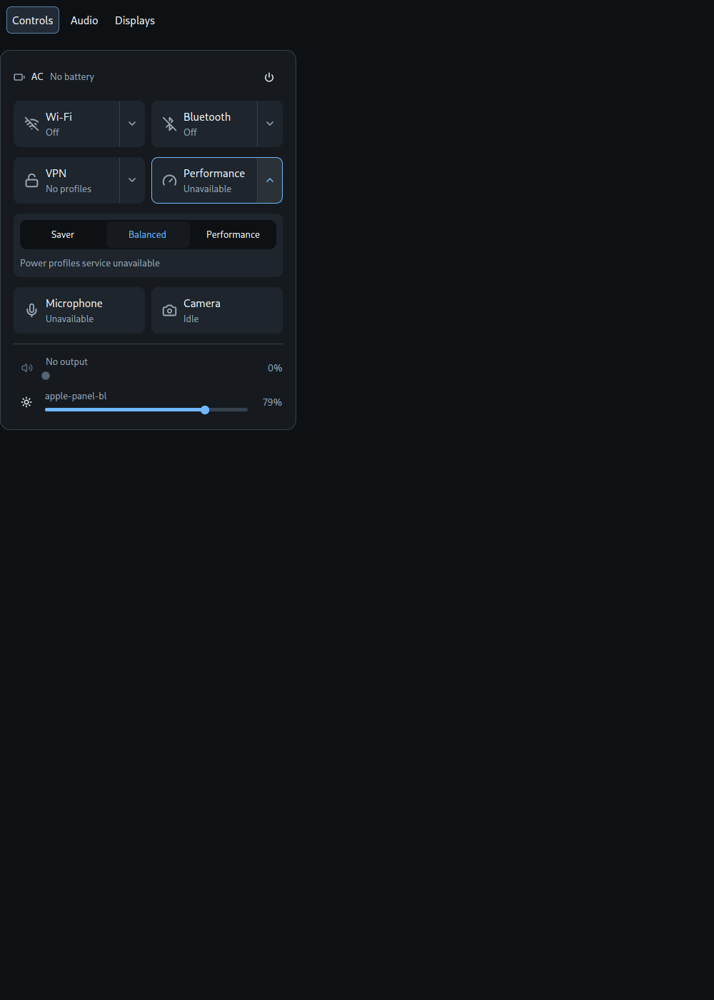
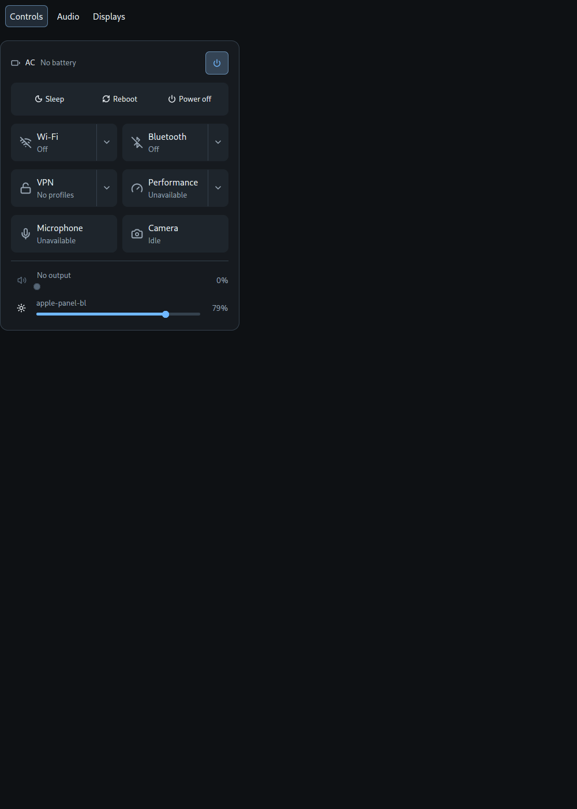
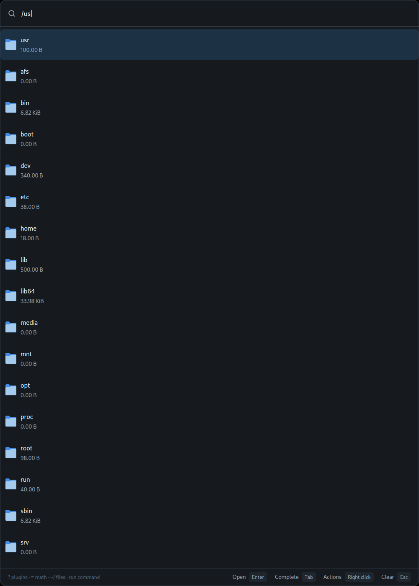
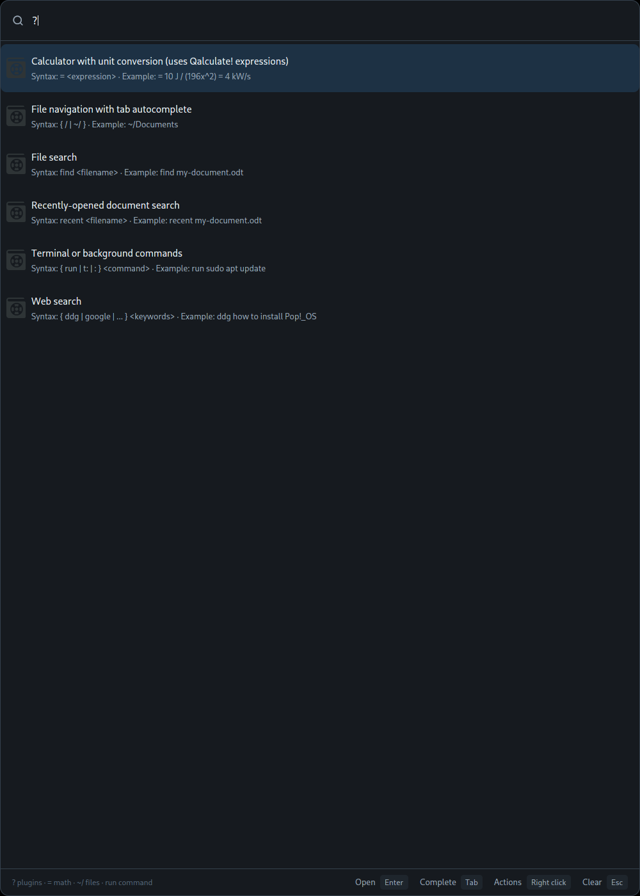

# Starshell — Design Specification

How the Starshell bar, applets and launcher look and behave (October 2026).
The document is independent of any code: the interface can be reproduced in
any codebase from it without porting an implementation. Reference
screenshots live in this folder; they were taken in headless sway with the
default font.

## 1. Principles

- **No pixels in markup.** Every size is a named token expressed in "design
  units" and derived from the current font size. Pixels appear only where the
  platform demands them (window size, popup offset, exclusive zone), and even
  those are computed from tokens.
- **Expand in place.** Nothing opens as a "nested screen". Details expand
  directly below whatever triggered them, at full width, without moving or
  shrinking their row neighbours.
- **One open applet.** Opening another one closes the current one.
- **Every interaction is animated**, except under "reduce motion" — then
  everything is instant.

## 2. Units and scale

- The design reference is a font of **13 units**. A token with value *N*
  equals *N / 13 rem*, i.e. it grows with the font.
- The default font is **15 px**: the whole interface is 15/13 ≈ 1.15 times
  larger than the reference. The user changes a single `font_size` setting in
  the theme; everything else follows.
- The bar height in the config is also in design units (default 28) and
  scales with the font.

### Spacing

| Token | Units | Purpose |
|---|---|---|
| Hairline | 1 | thin dividers |
| XXSmall | 2 | gap between lines inside a block |
| XSmall | 4 | dense groups |
| Small | 6 | label ↔ control |
| Medium | 8 | standard gap, card inner padding |
| Large | 12 | tile padding, gap between sections |
| XLarge | 16 | panel padding |
| XXLarge | 20 | |
| XXXLarge | 24 | inset of contextual actions below a launcher row |

### Radii

XSmall 2 · Small 4 · Medium 6 (buttons) · Large 8 (cards, tiles) ·
XLarge 12 (panel surface) · Full (pill).

### Text (fraction of the base font; px at 15)

| Step | Fraction | px |
|---|---|---|
| XSmall | 0.80 | 12 — footer hints, auxiliary |
| Small | 0.87 | 13 — statuses, labels, descriptions |
| Default | 1.00 | 15 — titles, body text |
| Medium | 1.08 | 16 |
| Large | 1.23 | 18 — track title |
| XLarge | 1.38 | 21 |

Rule: text smaller than 12 px is never used — below that the font
rasterizes poorly.

### Icons (units)

Indicator 10 · XSmall 12 · Small 14 · Medium 16 · Large 18 · XLarge 20 · XXLarge 48.

### Surface sizes (units)

| Token | Units | What |
|---|---|---|
| panel | 360 | width of the control center and narrow applets |
| device_panel | 400 | width of the audio and displays applets |
| launcher | 600 | launcher width |
| launcher_offset | 100 | launcher offset from the top of the screen |
| applet_height | 440 | initial applet height before fitting to content |
| panel_max_height | 780 | panel height ceiling |
| panel_min_width / height | 200 / 160 | |
| viewport_inset | 48 | margin to the screen edge |
| tile | 56 | minimum tile height |
| control | 32 | icon-button square, leading icon of a slider |
| percentage_label | 36 | percentage column to the right of a slider |
| application_icon | 28 | result icon in the launcher |
| navigation_list | 240 | max height of a list inside an expanded panel (scrolls beyond) |
| bar_chip | 22 | chip in the bar |
| slider: hitbox / track / thumb | 16 / 4 / 10 | |
| switch: width / height / knob | 32 / 18 / 12 | |
| cover | 72 | track cover art |
| playback | 40 | round play/pause button |

## 3. Color

Palette roles (the theme provides values; every surface uses roles only):

- `background` — base under everything, segmented control backing;
- `surface` — panel surface;
- `elevated` — card inside a panel, inactive tile;
- `element_selected` — active tile, selected row;
- `ghost_hover` / `ghost_active` — hover and press highlight;
- `border_variant` — panel border, dividers, chevron divider;
- `accent` — accent: active tile icon, expanded tile border, selected
  segment, slider fill;
- `text` / `text_muted` — primary and secondary text;
- `error`, `warning`, `success` — statuses (mute, low battery, charging).

The palette can be derived from a single accent (hue *h* of the accent, HSL):
background (h, 19%, 6.6%) · surface (h, 18%, 10.3%) · elevated (h, 18%, 14.5%) ·
hover (h, 22%, 19%) · border (h, 18%, 25.5%) · text (h, 28%, 94%) ·
muted (h, 16%, 66%) · accent (h, 100%, 72%) · on-accent (h, 55%, 10.5%) ·
selection (h, 40%, 19%) · warning (h−175°, 82%, 70%) · error (h+140°, 70%, 74%).
Default accent is `#70b8ff`.

## 4. Surfaces

- **Panel** (control center, applet): `surface` background, 1 `border_variant`
  border, XLarge radius, XLarge inner padding, Large gap between blocks.
- **Card** (expanded panel, display card): `elevated` background, Large
  radius, Medium padding.
- An applet hangs a Medium gap away from the bar, anchored to the click
  point, shifts along the bar if it does not fit, and never overlaps the bar.
  Its height fits the content but never exceeds the screen minus XLarge;
  beyond that it scrolls.
- An applet appears with a 40 ms ease-out (cubic) fade-in.

## 5. Control center

Top to bottom:

1. **Header**: battery icon (color by state: error when ≤ critical, success
   while charging, warning when ≤ 20%, otherwise text) · "84%" (medium
   weight) · "≈ 2h 10m left / until full" (Small, muted, truncated) · on the
   right icon-buttons: wallpapers (replaces the control center with the
   wallpaper applet at the same spot), settings (closes the overlay and opens
   the settings window), and power, highlighted while open.
   The power button expands, in place below the header, a row of actions:
   Sleep, Reboot, Power off.
2. **Tile grid**, 2 columns, Medium gap, in this order:
   Wi-Fi · Bluetooth / VPN · Performance / Microphone · Camera.
3. Divider.
4. **Sliders**: output volume, then one per controllable display.

### Tile

- A cell of a fixed grid: all tiles in a row have the same width and height
  (minimum `tile`); content never affects neighbours.
- **Horizontal** layout: icon (Large) on the left, to the right a column of
  title (Default) and status (Small, muted); both truncate with an ellipsis.
- Padding: Large horizontal, Medium vertical; icon ↔ text Medium.
- Large radius, 1 border.
- States:
  - inactive — `elevated` background, muted icon;
  - active — `element_selected` background, `accent` icon;
  - expanded — `accent` border (transparent otherwise), chevron points up
    and is `accent`.
  Background and border transitions take 80 ms, ease-out (cubic), resuming
  from the current value when the direction changes.
- Two hit zones: the **body** (toggles) and the **chevron** on the right
  (expands the panel), separated by a vertical `border_variant` line. Each
  zone highlights on hover (smoothly) and on press.
  A tile without a toggle expands on a body press; a tile without a panel
  (Microphone, Camera) has no chevron.

| Tile | Body | Status | Active | Panel |
|---|---|---|---|---|
| Wi-Fi | toggle Wi-Fi | network name / Not connected / Off | Wi-Fi on | networks |
| Bluetooth | toggle adapter | device name / N devices / No devices / Off | adapter on | devices |
| VPN | disconnect the active one, otherwise bring up the first profile; with no profiles — open the panel | active name / Connecting… / Off / No profiles | tunnel up | profiles |
| Performance | next profile, cycling | Saver / Balanced / Performance / Unavailable | profile ≠ Balanced | segmented choice |
| Microphone | mute the source | On / Muted / Unavailable | not muted | — |
| Camera | — | In use / Idle | camera in use | — |

### Expanded panel

- Appears **directly below the row** of its tile, spanning the full row
  (from the left edge of the left tile to the right edge of the right one).
  Rows below shift down; the row above and the row itself neither move nor
  resize.
- At most one is open; pressing the chevron again closes it.
- Appearance: fade 0 → 1 and slide in from above by Medium over 80 ms,
  ease-out (quint). The slide is a visual offset and does not move layout.
- The content has no header of its own (the tile plays that role). At the
  top there is a line: a Small muted label ("Connected to X" / "Networks" /
  "Devices" / "Scanning…") and on the right a refresh/scan icon-button.
- **List row** (network, device, VPN profile): full width, Medium × Small
  padding, Small icon, Small name + Small status (`accent` when connected),
  truncated. The connected row is highlighted with `element_selected`. Row
  actions are icon-buttons on the right (disconnect, forget); pressing them
  does not activate the row. Hover/selection are animated.
- The Wi-Fi password input expands in place of the network row.
- A list longer than `navigation_list` scrolls inside the panel.
- **Performance**: segmented control — `background` backing, XXSmall
  padding, three equal buttons Saver / Balanced / Performance, the selected
  one shows `accent` text on the selection color.
- **VPN**: one row per saved NetworkManager profile (VPN and WireGuard). Row:
  a lock icon (closed and `accent` when the tunnel is up, open and muted
  otherwise), profile name in Small, below it "WireGuard · connected" /
  "VPN · connecting… / disconnecting… / off" (`accent` when up).
  Pressing the row brings the tunnel up or down; while disconnecting the row
  is inactive. On the right of each row is a pencil icon — open the profile
  in the connection editor (`nm-connection-editor --edit <uuid>`); the applet
  closes so the editor receives input. At the bottom is a "Manage profiles"
  button — the same editor without a profile (add, import). With no
  profiles — the label "No VPN profiles yet" and the same button. A
  connection error is a Small `error` line below the list:
  "<profile>: <reason>".

### Slider row

`[leading element] [label above the slider] [percentage]`:
- the leading element is a `control` square: for volume a mute button
  (volume icon, `error` when muted), for a display a sun icon;
- in the middle a Small muted label (output / display name, truncated) and
  below it the slider across the remaining width;
- on the right the percentage in Small muted, `percentage_label` column,
  right-aligned.
- The slider fill smoothly catches up with the value (80 ms).

## 6. Bar applets

The same rows and cards as in the control center, without nested screens.

- **Audio** (`device_panel` width): an "Output" section (Small muted, medium
  weight) — outputs listed as rows, the selected one tinted with the accent
  and a check mark; volume slider; divider; "Applications" — a slider per
  stream and below it output selection as an in-place dropdown; divider;
  "Input" — microphone selection and a level slider. Technical device names
  are never shown.
- **Displays**: a card per display (icon, name, connector, backend
  "Backlight / DDC/CI" on the right) with a slider row inside; at the bottom
  a "Change brightness together" switch.
- **System**, **media player** — `panel` width, initial height
  `applet_height`.

## 7. Launcher

- Window `launcher` × `applet_height`, top center, `launcher_offset` from the
  top, above everything, exclusive input.
- Skeleton: query line with a search icon → result list → footer with the
  prefix hints in XSmall muted. Key hints are left out: completion and
  actions only exist for some plugins.
- Placeholder: "Search apps, windows and files".
- **Backend — pop-launcher**, no modes of its own. Every query goes to the
  service; an empty query shows open windows.
- Result row: `application_icon` icon (from the icon theme, for files — by
  mime type), title in Default and description in Small muted (newlines →
  " · "), both truncated; the selected row is highlighted.
- Enter — activate (the launcher does what the service answers: launch an
  app, fill in text, close). Tab — complete the query.
  Right click — the result's actions expand **below the row**, in place, as
  outline buttons.
- Esc: the first clears the query, the second closes.
- If the service is unavailable — an error message instead of the list.

## 8. Motion

| What | Duration | Curve |
|---|---|---|
| hover/press/selection, tile background and border, slider | 80 ms | ease-out cubic, reversible |
| expanded panel appearance | 80 ms | ease-out quint, fade + slide by Medium |
| applet appearance | 40 ms | ease-out cubic, fade |
| bar show/hide (auto-hide) | 180 ms | — |

Auto-hide slides the bar fully off screen and keeps an invisible 2-unit
strip at the edge that reveals it on hover; an open applet keeps the bar
shown.
Under reduce motion all transitions are instant.

## 9. Verification

Appearance is verified by scenarios in headless sway (a podman container),
not on the working session. A scenario presses elements by named probes and
checks layout facts, not pixels:

- expanding any panel does not move or resize the tiles of its row and the
  rows above;
- an expanded panel starts below its tile and spans from the left tile of
  the row to the right one;
- after closing everything returns to its original place;
- nothing overflows the panel;
- launcher: the file plugin answers `/us`, Tab completes to `/usr/`,
  `?` lists the plugins, Esc clears the query.

## 10. Screenshots

| State | File |
|---|---|
| Control center, everything collapsed |  |
| Wi-Fi expanded |  |
| Bluetooth expanded |  |
| VPN expanded |  |
| Performance expanded |  |
| Power actions expanded |  |
| Launcher: files for `/us` |  |
| Launcher: `?`, plugin list |  |
